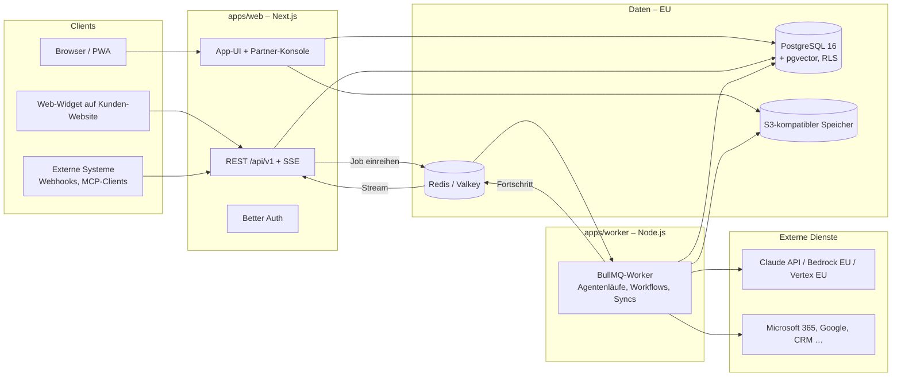
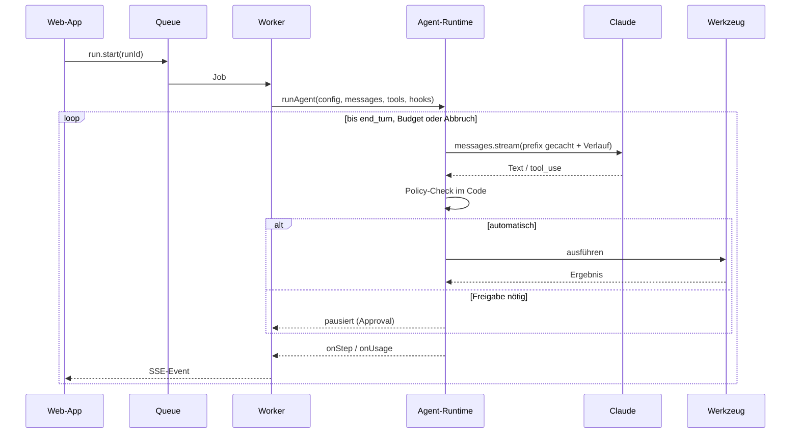

# Architektur – ME-IT Nexus

Stand: Phase 0–2 (Kern umgesetzt), dazu Agent Studio und Freigabe-Inbox. Dieses Dokument wird mit jeder Phase aktualisiert. Die Begründungen der wichtigsten Entscheidungen stehen in [`docs/adr/`](adr/).

## 1. Systemübersicht

**Grundsatz:** Die Web-App nimmt Anfragen an, prüft Rechte und reiht langlaufende Arbeit ein. Der Worker führt Agentenläufe und Workflows aus. Der Fortschritt läuft über einen Redis-Stream pro Lauf zurück (`nexus:run:<id>:events`, eine Stunde gültig) und wird per Server-Sent Events (SSE) an den Browser gestreamt. Weil der Stream von Anfang an gelesen wird, verpasst auch ein später verbundener Browser kein Ereignis. Der dauerhafte Zustand liegt immer in Postgres; Redis ist nur Transport und Queue.

## 2. Pakete

| Paket                             | Verantwortung                                                                                                     | Darf importieren |
| --------------------------------- | ----------------------------------------------------------------------------------------------------------------- | ---------------- |
| `packages/config`                 | gemeinsame TypeScript- und ESLint-Presets                                                                         | –                |
| `packages/core`                   | Umgebungsvariablen, Logger, Fehler, Berechtigungen, Mandanten-Kontext-Typen                                       | –                |
| `packages/db`                     | Drizzle-Schema, Migrationen, RLS-Policies, Kontext-Helfer (`withTenant` …), Seeds                                 | `core`           |
| `packages/domain`                 | Fachdienste: Mandanten anlegen, Einladungen, Mitglieder, Berechtigungen auflösen, Audit-Hash-Kette, E-Mails, Seed | `core`, `db`     |
| `packages/ui`                     | Designsystem: Tokens, Palette aus Primärfarbe, Komponenten                                                        | –                |
| `packages/agents`                 | Agent-Runtime: Provider-Abstraktion, Modellstufen, Agentenschleife, Werkzeuge, Kosten                             | `core`           |
| `packages/connectors` _(Phase 4)_ | Connector-SDK und Konnektoren                                                                                     | `core`, `agents` |
| `packages/knowledge` _(Phase 3)_  | Parsing, Chunking, Embeddings, Suche                                                                              | `core`, `db`     |
| `apps/web`                        | UI, öffentliche API, Auth, SSE                                                                                    | alle Pakete      |
| `apps/worker`                     | Jobs: Agentenläufe, Workflows, Syncs, Zeitpläne                                                                   | alle außer `ui`  |

Abhängigkeiten zeigen nur nach unten. `packages/agents` kennt keine Datenbank; es bekommt Persistenz über Callbacks (`onStep`, `onUsage`) injiziert. Dadurch ist die Runtime ohne Datenbank testbar.

## 3. Mandanten-Isolation

Details: [ADR 0002](adr/0002-mandanten-isolation-rls.md).

- Eine gemeinsame Datenbank. Jede mandantenbezogene Tabelle hat `tenant_id uuid not null`.
- **Row Level Security** ist auf allen diesen Tabellen aktiviert und **erzwungen** (`FORCE ROW LEVEL SECURITY`), sodass sie auch für den Tabellen-Owner gilt.
- Die App verbindet sich mit einer Rolle **ohne** Superuser- und ohne `BYPASSRLS`-Recht.
- Jeder Datenbankzugriff läuft in einer Transaktion mit gesetztem Kontext:

| Helfer                       | Setzt             | Sieht                                                                                                                 |
| ---------------------------- | ----------------- | --------------------------------------------------------------------------------------------------------------------- |
| `withTenant(tenantId, fn)`   | `app.tenant_id`   | Daten genau eines Mandanten                                                                                           |
| `withPartner(partnerId, fn)` | `app.partner_id`  | Mandantenliste und Verwaltungsdaten (Nutzung, Abos) der eigenen Mandanten, **keine** Inhalte wie Chats oder Dokumente |
| `withUser(userId, fn)`       | `app.user_id`     | nur die eigenen Mitgliedschaften und deren Mandanten (Auswahl nach dem Login)                                         |
| `withSystem(reason, fn)`     | `app.system = on` | alles; nur für Worker-Systemjobs und Migrationen, jeder Aufruf wird geloggt                                           |

- Ohne Kontext liefert jede Abfrage auf mandantenbezogene Tabellen **null Zeilen**. Ein vergessener Filter führt also zu „nichts gefunden“, nie zu einem Datenleck.
- Eine Meta-Testsuite prüft, dass **jede** Tabelle mit `tenant_id` RLS aktiviert, erzwungen und mit Policy hat.

## 4. Identität und Berechtigungen

Details: [ADR 0004](adr/0004-auth-better-auth.md).

- **Better Auth** verwaltet Identität: Nutzer, Sitzungen, Konten (Passwort, Microsoft, Google), Verifizierung, 2FA, Passkeys. Diese Tabellen sind global.
- **Autorisierung** ist eigene Domänenlogik: `memberships` verbinden Nutzer mit Mandanten und einer Rolle; Partner-Mitarbeitende haben `partner_memberships`.
- Berechtigungen sind Konstanten im Code (`packages/core/src/permissions.ts`), Rollen sind Bündel davon. Systemrollen: `owner`, `admin`, `member`. Eigene Rollen pro Mandant ab dem Business-Paket.
- Jede Server Action und jeder API-Endpunkt ruft `requirePermission(ctx, "…")` auf. Die UI blendet nur aus, sie schützt nicht.

## 5. Agent-Runtime

Details: [ADR 0003](adr/0003-eigene-agentenschleife.md) und [ADR 0006](adr/0006-llm-provider-und-modellstufen.md).

- Der Code kennt nur **Modellstufen** (`smart`, `balanced`, `fast`); die Zuordnung zu Modell-IDs liegt in der Datenbank.
- **Gecachter Prefix:** Werkzeuge (sortiert) → Basis-Systemprompt → Agenten-Anweisungen. Datum, Nutzer und Kanal kommen als `<kontext>` in die erste Nachricht. Ein Test beweist, dass der Prefix zwischen zwei Läufen byte-identisch bleibt.
- Berechtigungen für Werkzeuge prüft der Code vor der Ausführung, nie das Modell.
- **Freigaben:** Braucht ein Werkzeugaufruf eine Freigabe, endet der Lauf mit `awaiting_approval`, und für jeden offenen Aufruf entsteht eine Zeile in `approvals`. Nach der letzten Entscheidung setzt die Web-App den Lauf auf `queued` und reiht ihn neu ein; der Worker lädt die Entscheidungen und macht beim offenen `tool_use` weiter (Schrittnummern laufen fort, Summen werden addiert). Der Redis-Stream des Laufs bleibt bestehen; das SSE-Endpoint überspringt das alte `done` der Pause, solange der Lauf wieder aktiv ist.

## 6. Konfiguration

Alle Umgebungsvariablen werden beim Start mit Zod geprüft (`packages/core/src/env.ts`). Fehlt etwas, bricht der Start mit einer verständlichen Meldung ab. Vorlage: [`.env.example`](../.env.example).

## 7. Lokale Entwicklung

- `docker compose up -d` startet Postgres (mit pgvector), Valkey und Mailpit. Ein S3-kompatibler Speicher kommt mit Phase 3 (Datei-Uploads) dazu.
- `pnpm db:migrate` und `pnpm db:seed` richten Schema und Demo-Mandant ein.
- `pnpm dev` startet Web-App und Worker.

Siehe [README](../README.md#entwicklung).
